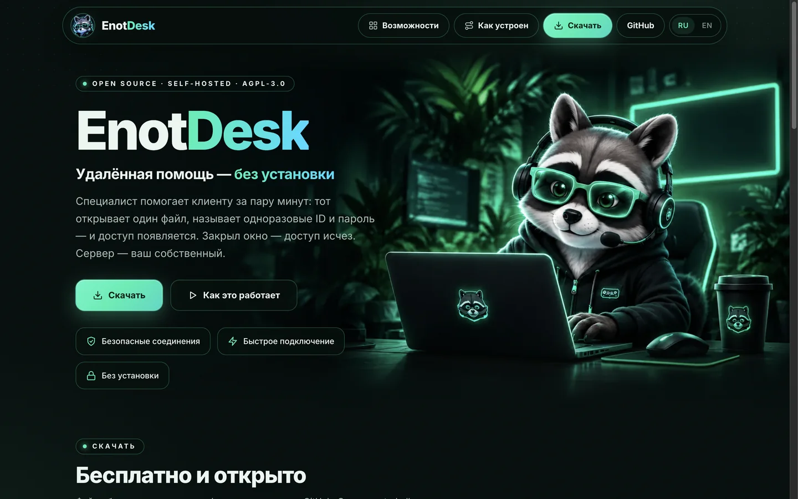
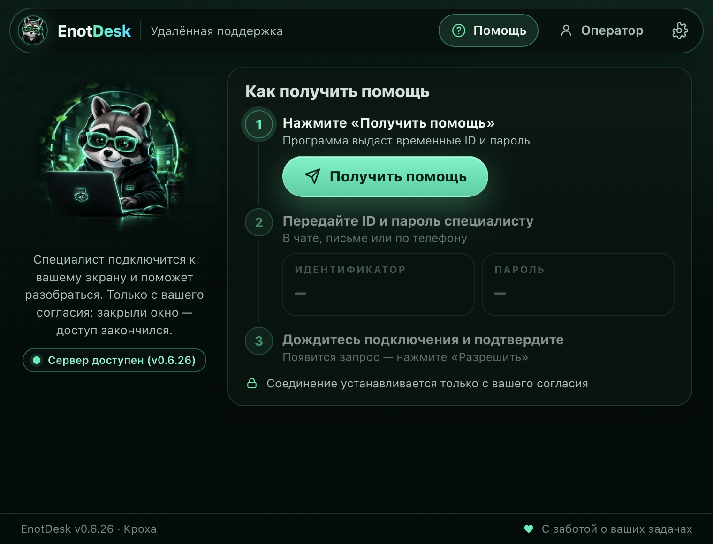
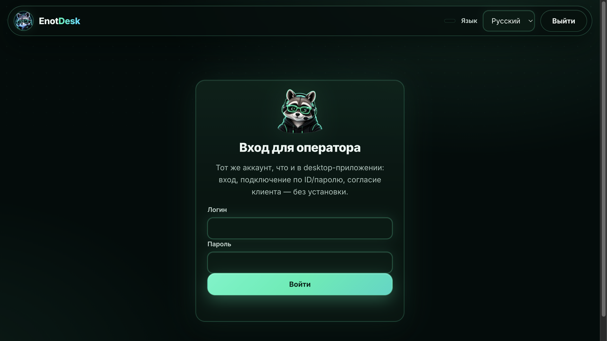
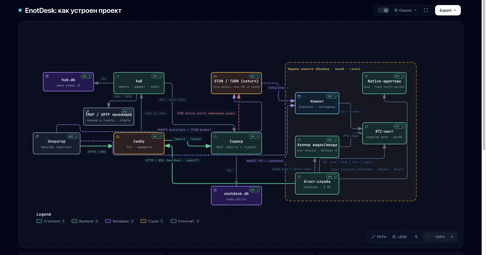

# EnotDesk

[English](README.md) | Русский

Self-hosted приложение удалённой поддержки для Windows, macOS и Linux. В базовом **attended**-режиме клиент запускает портативную программу без установки, получает одноразовые ID и пароль и передаёт их специалисту через свой обычный чат; закрытие приложения немедленно завершает доступ — никаких служб, автозапуска и фоновых процессов. Опционально — **постоянный доступ** (агент): на Windows служба ставится прямо из приложения (Настройки → «Машина»), на Linux и macOS — скриптами из `client/agent-service/` (на macOS агент работает в сеансе пользователя, с видео и управлением — ADR 0038); оператор забирает машину с обязательным указанием причины и опциональным PIN. Оператор работает из настольного клиента или обычного браузера; опциональный EnotDesk Hub добавляет тикет-систему с чат-виджетом, подключением в один клик и email-каналом.

## Скриншоты

Витрина (GitHub Pages) — тот же облик, что у страницы загрузок сервера:



Главное окно — сторона клиента: одна кнопка выдаёт одноразовые ID и пароль для оператора (смоук-снимок приложения):



Программа оператора — та же страница в браузере и в окне оператора приложения (экран входа):



## Архитектура

Как проект устроен целиком — оператор, сервер, хаб, TURN-ретранслятор и стек на машине клиента (необслуживаемые сеансы, видео/ввод-хелпер, RTC-мост):



Интерактивная версия схемы (панорама, поиск пути, линзы) опубликована на [GitHub Pages](https://flint-sega.github.io/enotdesk/architecture.html), рядом с [лендингом проекта](https://flint-sega.github.io/enotdesk/). Источник правды о карте — сам код: `server/` (REST + сигналинг), `hub/` (тикеты и чат-виджет), `client/` (приложение Electron и служба агента), `helper/video/` (хелпер видео/ввода для Windows).

## Как это работает

- **Клиент (получает помощь):** запускает portable-программу → «Получить помощь» → видит ID и одноразовый пароль → сообщает их оператору в своём чате → подтверждает подключение конкретного оператора → общается в чате, может скрыть экран одной кнопкой (пауза трансляции) и сменить показываемый экран на ходу → закрывает окно, когда помощь не нужна. Доступ существует только пока приложение открыто.
- **Оператор (оказывает помощь):** входит на сервере EnotDesk → берёт ID/пароль из чата (можно вставить целиком — подставятся сами) → подключается → после согласия клиента видит экран и управляет вводом (клавиатура работает на любой раскладке). В сеансе: чат, двусторонняя синхронизация буфера обмена, передача файлов, таймер и индикатор качества соединения; история сеансов и журнал — с экспортом в CSV.
- **Транспорт:** видео — WebRTC (DTLS/SRTP) напрямую между сторонами; сигналинг — через ваш сервер EnotDesk; ввод, чат, буфер и файлы — по DataChannel с жёсткими allowlist и лимитами. Короткий обрыв связи не убивает сеанс: 30 секунд (настраивается) на переподключение тех же участников; до согласия — мгновенный разрыв.

## Быстрый старт

**Установка одной командой (сервер):** интерактивный мастер на чистом Ubuntu/Debian-хосте (или любом хосте с Docker) — спросит домен, логин/имя/пароль администратора (пустой пароль = автогенерация, покажется один раз), порт и firewall, сам сгенерирует секреты TURN и `ENOT_SECRET_KEY`, поставит сервер, дождётся health и создаст первого администратора. Пароли и секреты передаются только через stdin-пайпы и окружение процесса — никогда через argv и логи.

```bash
curl -fsSL https://raw.githubusercontent.com/Flint-sega/enotdesk/main/scripts/quick-setup.sh | sudo bash
```

Варианты: `--docker` (стек compose в `./enotdesk-docker`), `--tarball <path>` (локальная сборка вместо релиза), `--update` (обновление; умолчания — из существующей установки), `--dry-run` (показать план, ничего не меняя), `--hub` / `--no-hub` (поставить или пропустить EnotDesk Hub; без флага — вопрос в интерактивном режиме), неинтерактивные флаги для CI (`--domain --admin-login --admin-name --port --no-firewall --admin-password-stdin`). Подробности: `scripts/quick-setup.sh --help` и [`docs/SERVER.md`](docs/SERVER.md).

**Docker (сервер одной командой):** `docker compose up -d` из каталога [`docker/`](docker/) — сервер EnotDesk + coturn (TURN) + Caddy (авто-HTTPS) сразу; подробности — README этого каталога.

**Локально из исходников** — требуется Node.js ≥ 24.12:

```bash
npm install          # koffi, ws; electron и electron-builder — точные пины в lockfile
npm run server       # control-plane на 127.0.0.1:8080 (SQLite)
npm run bootstrap    # первый администратор (интерактивно; существующий не перезаписывает)
npm start            # приложение EnotDesk (Electron)
```

Дальше в приложении: вкладка «Оператор» открывает программу оператора с сервера (`<сервер>/operator`, та же страница работает в любом браузере), «Получить помощь» — сторона клиента → адрес сервера по умолчанию `http://127.0.0.1:8080`. Для тестового HTTP-сервера включите галочку «Разрешить HTTP без шифрования» в настройках клиента; для адресов в интернете используйте HTTPS. Полный связный прогон серверного цикла (bootstrap → вход → приглашение → сессия → claim → согласие → сигналинг): `npm run smoke:local`.

### Проверка на одном компьютере

Приложение по умолчанию работает в одном экземпляре (второй запуск просто показывает существующее окно). Для проверки двух ролей на одной машине запустите второй экземпляр с тестовым обходом: для исходников — `EDESK_ALLOW_MULTI=1 npm start` из другого терминала, для собранного `.app` — `EDESK_ALLOW_MULTI=1 ./EnotDesk.app/Contents/MacOS/EnotDesk`. В первом окне нажмите «Получить помощь» и скопируйте ID с паролем, во втором откройте вкладку «Оператор» — программа оператора откроется отдельным окном, войдите и подключитесь по этим ID и паролю.

### Приглашение операторов и роли (админ)

Полный цикл: **админ** открывает программу оператора (`/operator` в браузере или вкладка «Оператор» в приложении) → «Команда» → выбирает роль → «Создать приглашение» → копирует ссылку вида `https://ваш-сервер/invite#token=…` (действует 24 часа). **Приглашённый** открывает ссылку в браузере и заполняет форму (имя, логин, пароль) прямо на странице, либо (в собранных версиях) переходит по `enotdesk://invite#token=…` — приложение откроет ту же страницу приглашения в окне оператора. После принятия участник входит со своим логином. Роли: **admin** управляет командой и машинами, **operator** подключается к сеансам, **auditor** видит только журнал аудита. Админ меняет роль, отключает и удаляет участников там же — раздел «Команда»; смена пароля и 2FA — раздел «Аккаунт» (последнего активного администратора удалить или понизить нельзя). Закреплённый ID ПК (attended-сеансы «получить помощь»): у клиента ID постоянный (хранится в настройках), пароль меняется при каждом запуске программы; машине-агенту (без присмотра) это не нужно — у неё свой постоянный токен.

Тесты: `npm test` (около 770 тестов: серверные и hub-HTTP/WS + client-швы + контракт рендерера) и `npm run lint`. Инъекция ввода в ОС тестами не выполняется — проверяются загрузка адаптера, валидация и координаты; реальную инъекцию проверяет человек (см. AGENTS.md).

## Сервер

Установка EnotDesk-сервера на Ubuntu/Debian (скриптом и вручную), systemd, обновление и удаление, бэкап БД, логи, HTTPS через Caddy, первый администратор — [`docs/SERVER.md`](docs/SERVER.md).

## EnotDesk Hub (тикет-система и чат)

EnotDesk Hub — опциональный сервис для поддержки: инбокс тикетов с живым чат-виджетом на вашем сайте, ссылки «подключиться» в один клик и email-канал «письмо → тикет». У хаба своя БД (`hub.db`); с сервером EnotDesk он общается через REST API, агенты входят в браузерную консоль `/hub/` обычными EnotDesk-аккаунтами (2FA работает, роли учитываются).

Установка вместе с сервером:

- одной командой: quick-setup спросит, ставить ли Hub (`--hub` / `--no-hub` фиксируют выбор для CI);
- docker: в `.env` добавить `COMPOSE_PROFILES=hub` и `HUB=1`, затем `docker compose up -d` — Caddy отдаёт `/hub`, `/widget.js`, `/w`, `/join` и `/api/hub/*`; сам порт хаба наружу не публикуется;
- из исходников: `node hub/main.mjs` (слушает `127.0.0.1:8090`).

Чат-виджет ставится на любую страницу одной строкой (`data-server` указывает на адрес хаба):

```html
<script src="https://hub.example/widget.js" data-server="https://hub.example"></script>
```

«Подключиться» в один клик: агент отправляет в тред карточку; на машине гостя протокол `enotdesk://` открывает установленный клиент EnotDesk (регистрируется сборками на всех трёх ОС), клиент стартует сеанс и сам сообщает его хабу — хаб автоматически claim'ит сеанс за этого агента. Если клиент не установлен, страница `/join` предлагает кнопку протокола и ссылку на скачивание.

Email-канал: в настройках администратора укажите реальный IMAP-ящик и SMTP-аккаунт («Проверить связь» проверяет обе стороны). Входящие письма становятся тикетами, ответы агентов уходят по SMTP с корректным `In-Reply-To`, а автоматические письма с собственных адресов (bounce, автоответчики) отсекаются. Пароли ящика хранятся только в шифротексте — для этого хабу нужен `ENOT_SECRET_KEY`.

Чек-лист живой приёмки всего перечисленного: [`docs/MANUAL-QA.md`](docs/MANUAL-QA.md), раздел «EnotDesk Hub (живая приёмка)».

## Сборка

Сборка portable-клиента под macOS (проверено на arm64), Windows и Linux: команды, артефакты, системные зависимости, разрешения macOS, подпись — [`docs/BUILD.md`](docs/BUILD.md). Фактический вес macOS-сборки: zip 112,1 МиБ (сжатие maximum, только ru/en ресурсы Electron), в приложение не попадают тесты и упаковочные иконки; старт из исходников — ~3,7 с до первой SMOKE-строки (включая фиксированную 2,5-секундную паузу смоука). Замеры и метод — в BUILD.md.

## Платформы

| Платформа | Сборка (npm run) | Артефакт | Проверено живьём |
|---|---|---|---|
| Windows 10/11 (x64) | `pack:win` | портативный `.exe` и установщик `setup.exe` | Да: клиент помощи, служба агента, окно оператора — на машинах стенда и реальном ПК; часть сценариев (экран входа, ввод через службу на реальном ПК) ещё проверяется |
| macOS 13+ (Apple Silicon) | `pack:mac` | `.dmg` и `.zip` с `EnotDesk.app` | Частично: сборка, запуск, окно оператора; сеанс помощи с видео и агент на Mac — ждут живой проверки |
| Linux (x86_64, X11) | `pack:linux` | `AppImage` | Да: клиент помощи и агент на Debian 13 (стенд); на Wayland — только показ экрана, без управления |

Что именно считается «готово» к 1.0 и что ещё не проверено — [`docs/ACCEPTANCE-1.0.md`](docs/ACCEPTANCE-1.0.md).

Название и иконка артефактов — EnotDesk (assets/icon.icns / icon.ico / icon.png; перегенерация — `npm run icons`; скрипт использует macOS-утилиты sips/iconutil и работает только на macOS).

## Релизы и обновления

Пуш тега `v…` запускает [.github/workflows/release.yml](.github/workflows/release.yml): три платформы собираются на GitHub-раннерах (перед сборкой — lint и тесты), артефакты прикладываются к GitHub Release вместе с `checksums-sha256.txt` (проверка: `sha256sum -c`) и файлами фида автообновления (`latest.yml`, `latest-linux.yml`). Неподписанная сборка macOS сама обновиться не может, поэтому фида установки у неё нет: версию она берёт из `latest.yml` и только сообщает о ней.

Собранный клиент раз в сутки проверяет этот фид (electron-updater, generic-провайдер). Установленная Windows-сборка (`setup.exe`) и Linux AppImage скачивают обновление в фоне и ставят его после подтверждения человеком — никогда посреди сеанса. Портативный `.exe` Windows и macOS-сборка сами себя не заменяют: клиент показывает уведомление о новой версии со ссылкой на страницу загрузок. В dev-режиме (`npm start`), смоук-прогонах (`EDESK_SMOKE=1`) и у безоконного агента автообновление отключено.

## Запуск без подписи

Покупные сертификаты Apple и Windows не используются (ADR 0037); mac-сборка подписывается собственным сертификатом проекта, если он задан в CI. Предупреждения ОС при первом запуске ожидаемы, короткий путь запуска:

- **macOS 15 и новее**: при первом открытии нажмите «Готово», затем «Системные настройки» → «Конфиденциальность и безопасность» → внизу «Всё равно открыть» для EnotDesk. **macOS 14 и старше**: правая кнопка по `EnotDesk.app` → «Открыть» → «Открыть». Если снова блокирует — `xattr -cr /путь/EnotDesk.app` снимает карантин. При первом запуске разрешите «Запись экрана» и «Универсальный доступ» (см. «Разрешения macOS» ниже).
- **Windows**: SmartScreen → «Подробнее» → «Выполнить в любом случае». Портативный `.exe` при подключении может вызвать окно брандмауэра Windows — «Отмена» тоже подходит, соединение работает.
- **Linux**: `chmod +x EnotDesk-linux-*.AppImage` и запустите.

## Разрешения macOS

- **Запись экрана (Screen Recording)** — оператор увидит экран только после разрешения в «Системные настройки → Конфиденциальность → Запись экрана». Без него захват честно сообщит об отказе.
- **Универсальный доступ (Accessibility)** — требуется для передачи управления мышью/клавиатурой. Без него приложение показывает статус, но не вводит.
- Сборка не подписана сертификатом Apple: первый запуск — как описано в «Запуск без подписи» выше.

## Ограничение Linux/Wayland

Захват и просмотр работают, но **передача управления вводом на Wayland не поддерживается** — приложение диагностирует Wayland и честно сообщает об этом (unsupported-control). Для управления запустите сеанс X11 (адаптер X11/XTest).

## Сервер и конфигурация

Сервер: Node 24 + SQLite (`node:sqlite`) + ws; API `/api/v1` и сигналинг `/signal`; пароли и токены в БД только хэшами; порт по умолчанию 127.0.0.1:8080 (loopback; внешний адрес требует HTTPS/WSS). Имена переменных — в `.env.example`:

- `ENOT_HOST`, `ENOT_PORT`, `ENOT_DB`, `ENOT_PUBLIC_URL` — адрес/порт/база/публичный URL страницы скачивания;
- `ENOT_TURN_URLS`, `ENOT_TURN_USERNAME`, `ENOT_TURN_PASSWORD` — STUN/TURN для сложных NAT. TURN-данные выдаются только аутентифицированным участникам сессии.

Значения вы задаёте сами локально. Секреты в репозиторий и отчёты не попадают.

## Страница скачиваний

`/downloads` показывает только реально собранные артефакты из `dist/` (allowlist имён). Отсутствующие сборки помечены как неготовые — фальшивых ссылок нет.

## Размещение

EnotDesk — self-hosted: сервер ставится на вашу машину (раздел «Сервер» и [`docs/SERVER.md`](docs/SERVER.md)), сеансы, учётные записи и журналы живут на нём. Видео идёт напрямую между сторонами или через ваш собственный TURN (coturn ставится установщиком). Внешний сервис только один: клиент раз в сутки сверяется с файлами обновлений на GitHub Releases проекта.

## Нативный ввод

Windows SendInput, macOS CoreGraphics, Linux X11/XTest — через [koffi](https://www.npmjs.com/package/koffi) (точный пин в `package.json`), без устанавливаемых служб. Нет koffi или API недоступен — приложение честно сообщает о недоступности управления.

## Сообщество

- Правила участия и стиль кода — [CONTRIBUTING.md](CONTRIBUTING.md).
- Сообщить об уязвимости (приватно) — [SECURITY.md](SECURITY.md).
- Кодекс поведения — [CODE_OF_CONDUCT.md](CODE_OF_CONDUCT.md).

## Лицензия

Проект распространяется под [GNU AGPL-3.0](LICENSE): облачные провайдеры, предлагающие EnotDesk как сервис, обязаны открывать исходники своих изменений. Ассеты — оригинальная авторская графика, см. assets/README.md. Зависимости — со своими лицензиями (electron MIT, ws MIT, koffi MIT).
